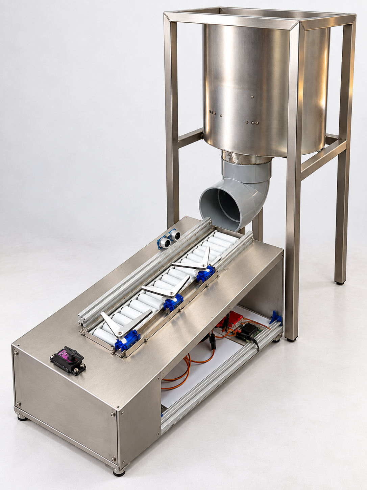
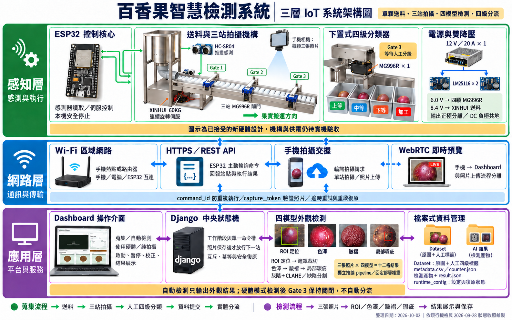
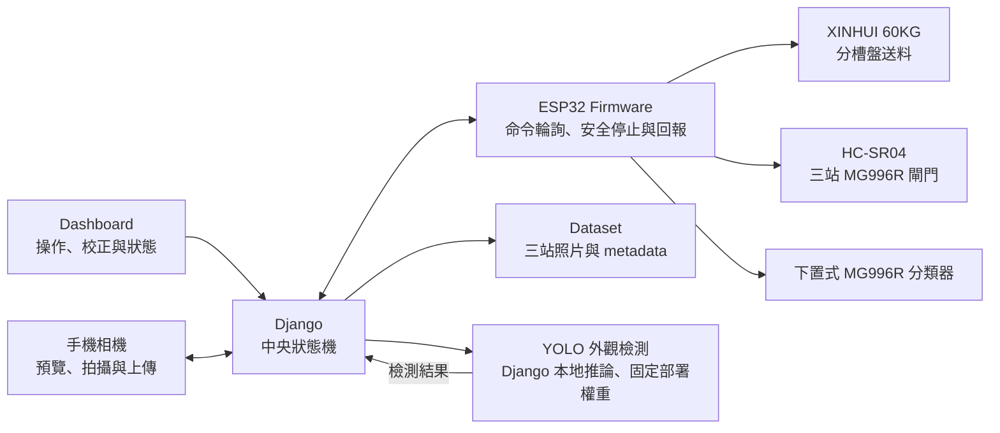

# 百香果 IoT 三站影像採集與分類系統

本專案整合 ESP32、Django、手機相機與伺服機構，建立百香果單顆送料、三站定點拍攝、Dataset 管理與四級實體分流。現行軟體已接入送料、三站拍攝、Gate 3 等待人工分類與複合分流，也提供純拍攝、YOLO 外觀檢測及區域網路配網；新平台、送料機構、分類器與供電的完整實機驗收仍未完成。



上圖為早期機構參考，與新平台及下置式分類器配置有差異；現行設計見下方架構圖與規格文件。

## 專案目標與硬體蒐集流程

百香果的外形、大小與蒂頭方向差異明顯，滾動拍攝容易產生模糊、角度不一致或漏拍。本系統讓果實停在三個固定站點，只有照片成功保存且下一段硬體安全條件成立時才繼續移動。

以下為使用硬體的蒐集模式軟體交握與目標硬體配置，完整實體流程仍待驗收：

1. XINHUI `60KG` 連續旋轉伺服帶動分槽送料盤，送出一顆百香果。
2. HC-SR04 確認果實抵達，ESP32 在本機停止送料馬達。
3. 三顆位置型 MG996R 閘門讓果實依序停在三個拍攝站點，手機依 Django 指示拍攝並上傳照片。
4. 第 3 張照片保存後，Gate 3 保持關閉，果實留在第 3 站等待分類。
5. 操作員檢查照片並完成人工分級，Django 先提交 Dataset 與 metadata，再建立 `classify_fruit`。
6. 分類器先轉向目標出口，完成就位等待後直接放行 Gate 3。
7. 分類器保持目標角度等待落果，再讓三個閘門與分類器一起歸位並回報完成。
8. 完整分類動作成功且自動運轉與安全條件仍成立時，Django 才允許送入下一顆果實。

> [!NOTE]
> Gate 3 等待分類與複合分流已完成軟體實作；MG996R 沒有位置回授，就位與落果仍依固定等待時間控制，不代表實體位置已確認。現行角度、timing 與安全契約見 [拍攝、檢測與分類規格](docs/CAPTURE_SPEC.md)，實機驗收狀態見 [目前狀態](docs/CURRENT_STATUS.md)。

純拍攝可在不連接 ESP32 的情況下自動拍攝三張。自動檢測模式已接入 ROI、色澤、皺褶與局部瑕疵四模型，顯示並保存結果，目前不產生品質級距；使用硬體檢測時固定執行單輪，Gate 3 保持關閉，後續須人工安全復原。

## 系統架構





Django 是 capture、送料與分類狀態的唯一來源。ESP32 以 HTTPS client 輪詢命令，在本機負責感測、馬達停止與有界硬體流程；手機處理相機 readiness、預覽、拍攝與上傳。本 Repository 維護 Django 本地推論、四個 YOLO 權重與兩個 XGBoost 判級模型（Git LFS），部署不需要外部模型 Repository 或資料。

硬體採單電源、雙 LM25116 降壓分支，分別供三站與分類器的 MG996R，以及 XINHUI 送料馬達。電壓設定見 [現行規格](docs/CAPTURE_SPEC.md)，接線、市電安全與負載驗收要求見 [硬體接線與驗收摘要](record_image/硬體接線與驗收摘要.md)。

## 我的主要負責項目

- 設計 ESP32 Firmware，整合 HC-SR04、送料、三站閘門與分類器。
- 建立 Django 與 ESP32 的 API、command ID、狀態機、互斥與 retry 流程。
- 整合手機相機頁、Dashboard、三站拍攝與 Dataset 生命週期。
- 設計並迭代拍攝平台、一體式送料筒、分槽送料盤與下置式分類器。
- 規劃單電源雙降壓分支、共地、感測器電平保護與實機驗收方式。
- 維護系統規格、架構決策與硬體文件。

## 目前進度

實作與驗收狀態以 [目前狀態](docs/CURRENT_STATUS.md) 為準；未完成工作的詳細規格與討論由 [GitHub Issues](https://github.com/Eten0721/PassionFruit_IoT_hardware/issues) 追蹤。

### 已實作功能

- Django 中央狀態機可協調 HC-SR04、手機單站拍攝與 ESP32 三站閘門。
- 每顆果實可保存三張站點照片，照片原子保存成功後才推進流程。
- Dashboard 可管理拍攝 timing、送料校正、照片檢查、人工分類與刪除。
- Capture、送料與 sorter 共用單一 motor command slot，command ID 與 retry 具備冪等保護。
- HC-SR04 正式送料與測試送料共用回授停止、最大運轉時間與感測器 unavailable 安全停止。
- Gate 3 等待人工分類、分類器先轉向再開閘、四顆馬達共同歸位與跨重啟復原鎖已接入。
- 純拍攝與硬體模式皆可執行三張照片的四模型檢測、結果展示與保存；檢測不驅動實體分流。
- Dashboard 網路確認、相機 QR、ESP32 動態探索、失聯安全鎖與安全閒置 BOOT 配網已接入。
- 正式 Firmware 已依感測、閘門、分類器、HTTPS 與流程控制拆分模組。

### 待完成與實機驗收

- 完成新平台、XINHUI 分槽送料盤、下置式分類器與單電源雙降壓分支的製作、校正及完整流程驗收。
- 三站閘門目前直接寫入 Home／Release 角度；只有新平台實測仍會夾果時，才評估非阻塞小角度遞增。
- 驗證配網、換網、失聯停止延遲、斷電保存與重新啟動後的實體位置及人工復原。
- 建立 Dataset 第二份備份、正式 train／valid／test 切分、標註與模型驗收；AI 自動品質分級與實體分流尚未接入。

## 技術組成

| 類別 | 技術與裝置 |
|---|---|
| Backend | Python `3.14.4`、Django `5.2.16` LTS、REST API |
| Frontend | HTML、CSS、JavaScript、WebRTC |
| Firmware | ESP32、Arduino C++、ESP32Servo `3.2.1` |
| Target hardware | HC-SR04、XINHUI `60KG`、4 顆位置型 MG996R、單電源與雙 LM25116 降壓分支 |
| Detection / Data | YOLO、JPEG、CSV metadata、檔案系統 Dataset 與檢測產物 |
| Engineering | Git、GitHub Issues、ADR、模組化狀態機與實機驗收 |

## Repository 結構

```text
PassionFruit_IoT_hardware/
├── Django_Server/      # Dashboard、API、狀態機、Dataset 管理與正式部署權重
├── firmware/           # 正式 ESP32 Firmware
├── docs/               # 架構、規格、現況、ADR 與部署
├── record_image/       # 接線安全、驗收摘要、實際硬體與設計圖
├── 環境部署/           # ESP32 快速燒錄準備與部署筆記
└── external/           # 選用的模型訓練開發說明與 ignored checkout
```

模型訓練、研究推論 pipeline 與候選權重由獨立的 [ps-quality-detection-system](https://github.com/fcu-passionfruit-project/ps-quality-detection-system) Repository 維護，只有模型開發需要依 [external/README.md](external/README.md) 建立 checkout。正式部署與權重替換只使用本 Repository 的 [Django_Server/models/](Django_Server/models/README.md)。Dataset、原始照片、檢測產物與訓練輸出不納入本 Repository。

## 文件導覽

- [部署與操作說明](docs/環境部署說明文件.md)
- [專案脈絡與架構](docs/PROJECT_CONTEXT.md)
- [目前狀態](docs/CURRENT_STATUS.md)
- [拍攝、檢測與分類規格](docs/CAPTURE_SPEC.md)
- [硬體接線與驗收摘要](record_image/硬體接線與驗收摘要.md)
- [ADR-0016：硬體平台、送料與分類器重構](docs/adr/0016-hardware-platform-feeder-sorter-redesign.md)
- [架構決策索引](docs/adr/README.md)

> [!CAUTION]
> 現行安全模型只適用可信任且隔離的實驗室區網。將系統部署至公開網路前，必須完成 TLS 憑證驗證、API authentication、production settings 與其他安全稽核項目。
