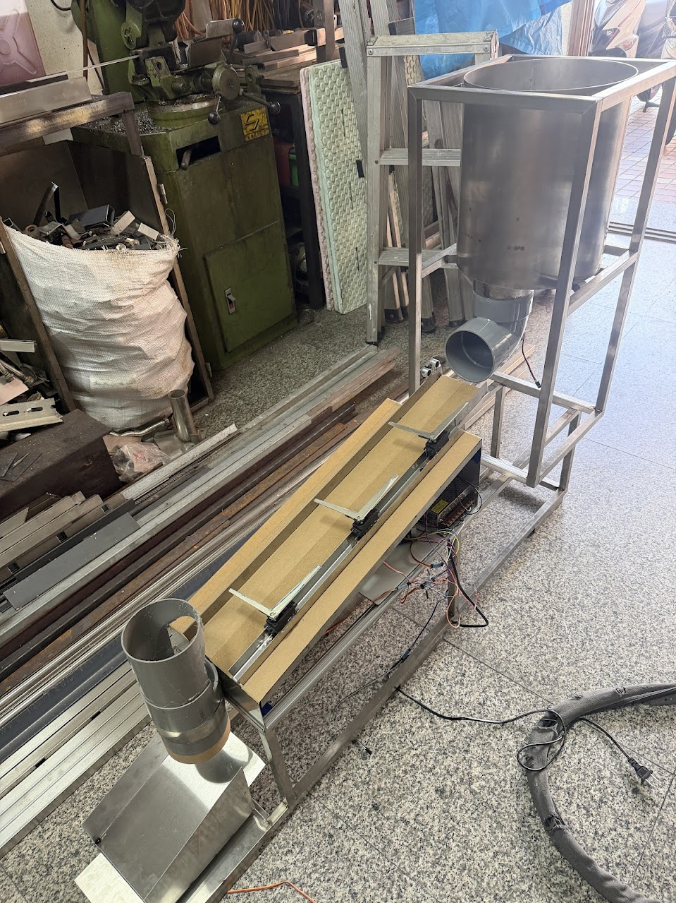
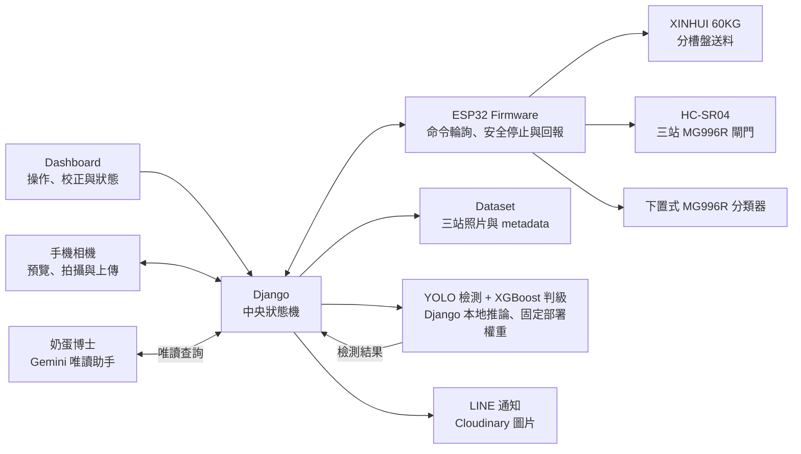

# 百香果 IoT 三站影像採集與分類系統

## 快速開始（Windows）

從 [Releases](https://github.com/Eten0721/PassionFruit_IoT_hardware/releases) 下載最新版的 **Source code (zip)** 並解壓縮，雙擊 `啟動系統.bat`；第一次會自動安裝所需環境，完成後開啟 Dashboard。只用電腦與手機相機時，依 [快速開始（不含 ESP32）](docs/快速開始.md) 操作；ESP32 配網、硬體模式與更新方式見 [完整部署與操作說明](docs/環境部署說明文件.md)。

## 概要

本專案整合 ESP32、Django、手機相機與伺服機構，建立百香果單顆送料、三站定點拍攝、Dataset 管理與四級實體分流。可以做到果實送料、三站拍攝、Gate 3 等待分類與複合分流，也提供 YOLO 外觀檢測與 XGBoost 四級判級、加工果 LINE 通知、瑕疵趨勢提醒、 AI 助手「奶蛋博士」及裝置網路快速配網。

<p align="center">
  
</p>

上圖為依 [ADR-0016](docs/adr/0016-hardware-platform-feeder-sorter-redesign.md) 製作的實機：右上為一體式送料筒，中段為三站閘門拍攝平台，左下為平台出口的下置式分類器；已於 2026-10-27 完成完整實機驗收。

## 專案目標與自動檢測流程

百香果的外形、大小與蒂頭方向差異明顯，滾動拍攝容易產生模糊、角度不一致或漏拍。**本系統讓果實停在三個固定站點拍攝**，由 AI 判級後直接分流到對應籃子。

1. **送料**：XINHUI `60KG` 帶動分槽送料盤送出一顆百香果，HC-SR04 確認抵達後 ESP32 停止送料。
2. **三站拍攝**：三顆 MG996R 閘門讓果實依序停在三個站點，手機拍攝並上傳，每張保存成功才放行下一站。
3. **AI 檢測**：三張照片依序經 ROI、色澤、皺褶與局部瑕疵四個 YOLO 模型處理。
4. **判級**：兩階段 XGBoost 逐張判級，整顆取三張最低級；無法判級時由操作員人工選級。
5. **保存**：原圖、處理圖、`result.json` 與檢測總表先存檔，Dashboard 同步顯示每個模型的結果。
6. **實體分流**：分類器轉到對應等級出口，再放行 Gate 3；落果後閘門與分類器一起歸位。
7. **下一顆**：分類完成且安全條件成立才送下一顆；加工果同時以 LINE 通知。

> [!NOTE]
> MG996R 沒有位置回授，就位與落果依固定等待時間控制。角度、timing 與安全契約見 [拍攝、檢測與分類規格](docs/CAPTURE_SPEC.md)。

另有不接 ESP32 的純拍攝模式，可只用手機拍三張並執行同樣的 AI 檢測。

檢測結果另有三項延伸功能：加工果可經 LINE 發送圖文通知；Dashboard 提供檢測統計與瑕疵趨勢提醒；奶蛋博士以 Gemini 回答檢測統計、農業知識、部署操作與目前系統狀態，只查詢、不操作機器。契約見規格的 [LINE 通知](docs/CAPTURE_SPEC.md#檢測資料與-line-通知)、[統計與趨勢提醒](docs/CAPTURE_SPEC.md#檢測統計與趨勢提醒) 與 [奶蛋博士](docs/CAPTURE_SPEC.md#奶蛋博士)。

## 系統架構




Django 是 capture、送料與分類狀態的唯一來源（REST API）。ESP32 以 HTTPS client 輪詢命令，在本機負責感測、馬達停止與有界硬體流程；手機處理相機 readiness、預覽、拍攝與上傳。本 Repository 維護 Django 本地推論、四個 YOLO 權重與兩個 XGBoost 判級模型（Git LFS），部署不需要外部模型 Repository 或資料。

硬體採單電源、雙 LM25116 降壓分支，分別供三站與分類器的 MG996R，以及 XINHUI 送料馬達。電壓設定見 [現行規格](docs/CAPTURE_SPEC.md)，接線、市電安全與負載驗收要求見 [電源供應器接線注意事項](record_image/電源供應器接線注意事項.md)。

## 我的主要負責項目

- 設計 ESP32 Firmware，整合 HC-SR04、送料、三站閘門與分類器。
- 建立 Django 與 ESP32 的 API、command ID、狀態機、互斥與 retry 流程。
- 整合手機相機頁、Dashboard、三站拍攝與 Dataset 生命週期。
- 設計並迭代拍攝平台、一體式送料筒、分槽送料盤與下置式分類器。
- 規劃單電源雙降壓分支、共地、感測器電平保護與實機驗收方式。
- 維護系統規格、架構決策與硬體文件。
- 協助訓練ROI, color, wrinkle的 YOLO 模型。
- 規劃多模型檢測流程與 XGBoost 兩層檢測架構。
- 將AI模型檢測流程納入硬體流程當中，完成系統整合。

## 目前進度

實作與驗收狀態以 [目前狀態](docs/CURRENT_STATUS.md) 為準；未完成工作的詳細規格與討論由 [GitHub Issues](https://github.com/Eten0721/PassionFruit_IoT_hardware/issues) 追蹤。

## 技術組成

| 類別 | 技術與裝置 |
|---|---|
| Backend | Python `3.14.4`、Django `5.2.16` LTS、REST API |
| Frontend | HTML、CSS、JavaScript、WebRTC |
| Firmware | ESP32、Arduino C++、ESP32Servo `3.2.1` |
| Target hardware | HC-SR04、XINHUI `60KG`、4 顆位置型 MG996R、單電源與雙 LM25116 降壓分支 |
| Detection / Data | YOLO、XGBoost、JPEG、CSV metadata、檔案系統 Dataset 與檢測產物 |
| Integrations | LINE Messaging API、Cloudinary、Gemini REST API、Chart.js |
| Engineering | Git、GitHub Issues、ADR、模組化狀態機與實機驗收 |

## Repository 結構

```text
PassionFruit_IoT_hardware/
├── Django_Server/      # Dashboard、API、狀態機、Dataset 管理與正式部署權重
├── firmware/           # 正式 ESP32 Firmware
├── docs/               # 架構、規格、現況、ADR 與部署
└── record_image/       # 接線安全、驗收摘要、實際硬體與設計圖
```

模型訓練、研究推論 pipeline 與候選權重由獨立的 [ps-quality-detection-system](https://github.com/fcu-passionfruit-project/ps-quality-detection-system) Repository 維護，只有模型開發需要依 [模型開發環境](docs/模型開發環境.md) 在硬體 Repository 外建立 checkout。正式部署與權重替換只使用本 Repository 的 [Django_Server/models/](Django_Server/models/README.md)。Dataset、原始照片、檢測產物與訓練輸出不納入本 Repository。

## 文件導覽

- [快速開始（不含 ESP32）](docs/快速開始.md)
- [完整部署與操作說明](docs/環境部署說明文件.md)
- [專案脈絡與架構](docs/PROJECT_CONTEXT.md)
- [目前狀態](docs/CURRENT_STATUS.md)
- [拍攝、檢測與分類規格](docs/CAPTURE_SPEC.md)
- [電源供應器接線注意事項](record_image/電源供應器接線注意事項.md)
- [ADR-0016：硬體平台、送料與分類器重構](docs/adr/0016-hardware-platform-feeder-sorter-redesign.md)
- [架構決策索引](docs/adr/README.md)

> [!CAUTION]
> 現行安全模型只適用可信任且隔離的實驗室區網。將系統部署至公開網路前，必須完成 TLS 憑證驗證、API authentication、production settings 與其他安全稽核項目。
